<picture>
  <source media="(prefers-color-scheme: dark)" srcset="./assets/banner-dark.svg">
  <source media="(prefers-color-scheme: light)" srcset="./assets/banner-light.svg">
  
</picture>

<p align="center">
  <a href="https://albarazi.de"></a>
  <a href="https://cv.albarazi.de"></a>
  <a href="https://www.linkedin.com/in/manar-albarazi/"></a>
  <a href="mailto:manar@albarazi.de"></a>
</p>

### Hey, ich bin Manar 👋

Software Developer bei der **enventa Group** – ich entwickle ERP-Finanzsoftware für Zahlungsverkehr, Liquiditätsplanung und Buchhaltung. Nebenbei setze ich als Freelancer Web-, Branding- und Automatisierungsprojekte **end-to-end** um: von der Beratung über Design und Entwicklung bis zu Hosting und Wartung. Mein Workflow ist **KI-first** – mit eigenen MCP-Servern, Agenten und viel Automatisierung.

<table>
  <tr>
    <th width="33%">🏦 Finanzsoftware</th>
    <th width="33%">🌐 Web &amp; WordPress</th>
    <th width="33%">🤖 KI &amp; Automatisierung</th>
  </tr>
  <tr valign="top">
    <td>Module für Zahlungsverkehr, Liquiditätsplanung, Buchhaltung und Reporting. Bankschnittstellen nach <b>SEPA</b> (pain.001/008), <b>CAMT</b>.053/054 und <b>MT940</b>/942.</td>
    <td><b>50+ Projekte</b> für Startups und KMU. Eigene WordPress-Plugins mit Elementor-Widgets, Frontends mit React, TypeScript und GSAP.</td>
    <td>Eigene <b>MCP-Server</b> und KI-Agenten, Claude Code, OpenAI- und Claude-APIs, n8n-Workflows und Prompt Engineering.</td>
  </tr>
</table>

### 🧰 Tech-Stack

<p>
  <b>Backend &amp; Daten</b><br>
  <br>
  
  
  
</p>

<p>
  <b>Frontend</b><br>
  <br>
  
</p>

<p>
  <b>Web, KI &amp; Tools</b><br>
  <br>
  
  
  
  
  
</p>

### 🚀 Ausgewählte Projekte

| Projekt | Worum es geht | Stack |
|---|---|---|
| **[Dienstleistungs-Kostenrechner](https://github.com/m-barazi/service-calculator)** · [Live-Demo ↗](https://service-calculator-six.vercel.app) | Preislisten, Angebote, Rechnungen, Kunden-360°-Ansicht und PDF-Export für Dienstleister | React · TypeScript · Express · PostgreSQL |
| **[Holo-Interface](https://github.com/m-barazi/holo-interface)** | Glasmorphes Sci-Fi-Steuerzentrum für einen KI-Assistenten mit 3D-Avatar, Echtzeit-Telemetrie und Live-Chat | Next.js · Socket.IO · React Three Fiber · Docker |
| **[WebP-Converter 90s](https://github.com/m-barazi/webp-converter-90s)** | Bilder zu WebP – 100 % im Browser, keine Uploads, im Windows-95-Look | JavaScript · Canvas API · JSZip · Docker |
| **WP CV Plugin** <sub>(privat)</sub> | Lebenslauf DE/EN zentral pflegen: CV-Seite, Elementor-Widgets und ATS-taugliches PDF mit einstellbarem Layout | PHP · WordPress · Elementor · mPDF |

### 🧑‍💻 Kurz &amp; knapp

```ts
const manar = {
  role:       "Software Developer @ enventa Group",
  basedIn:    "Norddeutschland 🇩🇪",
  focus:      ["ERP-Finanzsoftware", "Web & WordPress", "KI-Automatisierung"],
  path:       ["Elektroniker", "Fachinformatiker AE (IHK)", "Software Developer"],
  languages:  ["Deutsch (C1)", "Englisch (B1)", "Arabisch (Muttersprache)"],
  askMeAbout: ["SEPA & CAMT", "Elementor-Plugins", "MCP-Server", "GSAP-Animationen"],
  openTo:     "Spannende Projekte rund um Fintech, Web und KI",
};
```

<picture>
  <source media="(prefers-color-scheme: dark)" srcset="https://raw.githubusercontent.com/m-barazi/m-barazi/output/github-snake-dark.svg">
  <source media="(prefers-color-scheme: light)" srcset="https://raw.githubusercontent.com/m-barazi/m-barazi/output/github-snake.svg">
  
</picture>

<p align="center"><sub>Vom Schaltschrank zum Code – heute verbinde ich Backend, Frontend, Design und KI. ⚡</sub></p>
